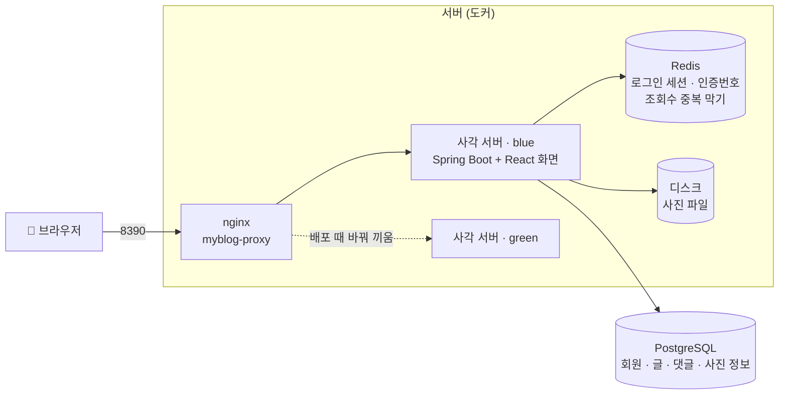
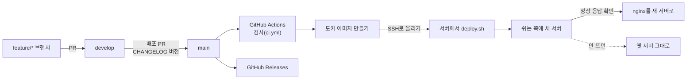

<div align="center">

# 사각

여러 회원이 각자 블로그를 하나씩 운영하는 다이어리형 블로그 서비스


**[sagak.java21.net](https://sagak.java21.net)**

</div>

| 항목 | 내용 |
|---|---|
| 기간 | 2026.10.08 ~ 진행 중 |
| 인원 | 개인 개발 (팀 공통 요구사항 기반) |
| 역할 분담 | **팀 공통**: 공통 기능 요구사항(CF-01~24)과 세부 규칙을 팀원과 함께 정의 · **개인**: 개인 기능(다이어리 · 꾸미기 등) 기획, 설계, 백엔드, 프론트엔드, 배포 |
| 배포 주소 | https://sagak.java21.net |
| 현재 버전 | v1.9.2 (2026-10-14) · 변경 이력: [CHANGELOG.md](CHANGELOG.md), GitHub Releases |
| 요구사항 · 설계 문서 | [`specs/001-blog-core/`](specs/001-blog-core/) · [home-my-blog/docs](https://github.com/home-my-blog/docs) |
| 개발 저장소 | [home-my-blog/myblog](https://github.com/home-my-blog/myblog) |
| 개발 방식 | AI 코딩 에이전트(Claude Code)를 활용한 스펙 주도 개발 ([AI 활용 방식](#ai-활용-방식)) |

## 소개

사각은 "다이어리를 꾸미며 쓰는 블로그"를 목표로 한 서비스다. 회원마다 블로그가 하나 생기고, 블로그 안에 다이어리(분류)를 여러 권 만들어 글을 쓴다.

- **글쓰기**: 마크다운 에디터, 사진 첨부, 임시저장(60초 자동), 공개 · 구독자만 · 비공개
- **읽기와 소통**: 댓글, 좋아요, 블로그 · 다이어리 구독, 책갈피 폴더
- **찾기**: 분야별 글, 통합 검색, 실시간 인기 검색어(5초마다 갱신)
- **꾸미기**: 활동에 따라 잉크 적립, 잉크로 스티커를 구매해 다이어리 표지 장식, 도전과제, 야간모드
- **회원**: 이메일 인증 가입, 소셜 로그인, 비밀번호 찾기, 탈퇴 후 30일 내 복구

| 메인 | 블로그와 다이어리 |
|---|---|
|  |  |
| **구독** | **스티커 상점** |
|  |  |

<sub>예시 데이터를 넣은 로컬 환경에서 촬영한 화면</sub>

## 기술 스택

| 영역 | 사용 기술 | 선택 이유 |
|---|---|---|
| 화면 | React 19, TypeScript, Vite | 화면과 상태가 많아 컴포넌트 단위 분리가 유리하고, 타입으로 API 응답 형태 오류를 줄일 수 있음. Vite는 개발 서버가 빠르고 `/api` 프록시 설정이 간단함 |
| 화면 데이터 | TanStack Query, react-markdown | 서버 데이터의 캐싱 · 재요청을 라이브러리에 맡겨 화면 코드를 단순화. 마크다운은 원시 HTML을 비활성화해 XSS 차단 |
| 서버 | Java 21, Spring Boot 3.5 | 현재 지원 중인 LTS · 안정 버전. record로 DTO와 검증 코드를 간결하게 작성 |
| 인증 | Spring Security, Spring Session(Redis) | 세션 + `HttpOnly` 쿠키 방식으로 탈퇴 · 비밀번호 변경 시 다른 기기의 로그인을 즉시 종료할 수 있음. 세션을 Redis에 두어 배포 후에도 로그인 유지 ([의사결정 1](#1-로그인-jwt-대신-세션--쿠키)) |
| DB 접근 | JdbcClient | 목록 · 통계 등 조건이 복잡한 조회가 많아, JPA 대신 SQL을 직접 드러내는 방식 선택 |
| 데이터 | PostgreSQL 16 (pg_trgm), Flyway | 별도 검색 서버 없이 인덱스로 한국어 부분 일치 검색 처리 ([의사결정 5](#5-검색-elasticsearch-대신-postgresql-pg_trgm)). 스키마 변경을 번호 붙은 SQL로 관리해 모든 환경에서 같은 순서로 적용 |
| 임시 데이터 | Redis 7 | 인증번호(10분) · 조회수 중복 방지(30분)처럼 만료 시간이 있는 값에 적합 ([의사결정 3](#3-redis-필수-기능과-선택-기능-구분)) |
| 배포 | Docker, nginx, GitHub Actions | `main` 병합 시 테스트 → 이미지 빌드 → 블루-그린 무중단 배포까지 자동화 ([의사결정 2](#2-무중단-배포-블루-그린--redis-세션)) |
| 협업 | Git Flow(main · develop · feature), PR 리뷰 | 기능은 `develop`에 모으고 배포 시점에만 `main`에 병합해 배포 횟수 조절 ([의사결정 7](#7-배포-단위와-버전-관리)) |



## 기술적 의사결정

개발 과정에서 검토한 선택지와 최종 선택, 그 이유를 정리했다.

### 1. 로그인: JWT 대신 세션 + 쿠키
- **고민**: 화면(React)과 서버가 분리된 구조에서는 JWT를 많이 쓰지만, JWT는 한 번 발급하면 만료 전까지 서버에서 무효화하기 어렵다.
- **선택**: 서버 세션 + `HttpOnly` 쿠키. 화면과 서버를 같은 주소에서 제공해 쿠키를 그대로 사용한다.
- **결과**: 비밀번호 변경 · 탈퇴 시 **다른 기기의 로그인도 즉시 종료**된다. 자바스크립트가 쿠키를 읽을 수 없어 토큰 탈취 위험이 줄었고, 대신 생기는 CSRF 위험은 `XSRF-TOKEN` 쿠키 + 헤더로 막았다. 로그인 5회 실패 시 10분 잠금, 존재하지 않는 이메일도 같은 처리 시간을 사용해 응답 속도로 가입 여부를 알 수 없게 했다.

### 2. 무중단 배포: 블루-그린 + Redis 세션
- **문제**: 기존 서버를 끄고 새 서버를 켜는 방식이라 배포 중 몇 초간 사이트가 중단됐다. 세션이 서버 메모리에 있어 **배포할 때마다 모든 회원이 로그아웃**됐고, 새 버전이 실행되지 않으면 사이트가 꺼진 상태로 남았다.
- **선택**:
  - 세션을 Redis로 이전(Spring Session). 서버가 교체되거나 두 대가 동시에 떠 있어도 같은 세션을 공유한다.
  - 8390 포트는 nginx가 받고, 대기 중인 쪽(blue/green)에 새 서버를 띄워 **정상 응답을 확인한 뒤에만** 트래픽을 전환한다. 기존 서버는 처리 중인 요청을 마친 뒤 종료한다(graceful shutdown).
- **결과**: 0.2초 간격으로 요청을 보내며 배포한 결과 **실패 0건**, 배포 전후 로그인 유지. 의도적으로 고장 낸 버전을 배포해도 기존 서버가 계속 서비스했다.
- **트레이드오프**: 전환 중 두 버전이 같은 DB를 사용하므로, 컬럼 삭제 · 이름 변경은 두 번의 배포로 나눠야 한다.

### 3. Redis: 필수 기능과 선택 기능 구분
- Redis는 짧은 시간만 유지하면 되는 값에 사용한다: 인증번호(10분), 조회수 중복 방지(30분), 댓글 연속 작성 방지(5초), 로그인 세션.
- `RedisGuard`로 장애 시 동작을 구분했다. 인증번호처럼 **필수인 기능**은 "잠시 후 다시 시도" 오류를 반환하고, 조회수 중복 방지처럼 **없어도 되는 기능**은 건너뛴다. Redis가 일시적으로 멈춰도 글 읽기는 계속된다.

### 4. 사진: 디스크 + DB 메타데이터, 확장자 대신 파일 내용으로 검사
- 사진 파일은 서버 디스크(도커 볼륨)에, 업로더 · 크기 등 메타데이터는 DB에 저장한다. 파일을 DB에 직접 넣으면 DB가 커지고 백업이 느려진다.
- 저장소는 `ImageStorage` 인터페이스로 추상화해, 설정 변경만으로 S3 호환 저장소(MinIO)로 전환할 수 있다.
- 파일 확장자 대신 **파일 앞부분의 매직 넘버**로 실제 이미지인지 검사한다. 파일명은 UUID로 새로 생성해 덮어쓰기와 개인정보 노출을 방지했다.
- 글에 사용되지 않은 채 24시간이 지난 사진은 1시간마다 정리한다.

### 5. 검색: Elasticsearch 대신 PostgreSQL pg_trgm
- 한국어 부분 일치 검색이 필요했지만, 서비스 규모에 비해 별도 검색 서버는 운영 부담이 크다고 판단했다.
- PostgreSQL `pg_trgm` 인덱스 + `ILIKE`로 한국어 부분 일치 검색도 인덱스를 사용하도록 했다.

### 6. 실시간 인기 검색어: 요청마다 계산하지 않기
- 요청마다 24시간 검색 기록을 집계하면 접속자가 늘수록 DB 부하가 커진다.
- 5초마다 한 번 계산해 메모리에 보관하고, 요청은 계산된 결과만 반환한다. 점수는 `검색 수 × 3 + 제목에 해당 단어가 포함된 글의 조회수 + 댓글 수 × 5`로 산정한다.

### 7. 배포 단위와 버전 관리
- 작은 수정마다 배포하면 배포가 잦고 느려져, **Git Flow**를 간소화해 적용했다. 기능은 `feature/*` → `develop`에 모으고, 배포 시점에만 `develop` → `main`으로 병합한다.
- `main`에 병합되면 GitHub Actions가 테스트 → 도커 이미지 빌드 → 서버 배포를 자동으로 수행한다. 공개 저장소이므로 비밀번호 등은 코드가 아닌 GitHub Secrets에 둔다.
- 버전은 `vX.Y.Z` 형식으로, 기능 추가는 가운데 숫자, 작은 수정은 끝 숫자를 올린다. `CHANGELOG.md`가 바뀌면 GitHub Release가 자동 생성된다.
- DB 구조는 Flyway의 번호 붙은 SQL 파일(V1~)로만 변경해, 모든 서버에서 같은 순서로 적용된다.

## AI 활용 방식

AI 코딩 에이전트(Claude Code)를 개발 도구로 활용했다. 무엇을 만들지와 어떻게 만들지는 직접 정하고, 코드 작성 · 테스트 · 문서화의 상당 부분을 AI에 맡긴 뒤 결과를 검토하는 방식으로 진행했다.

| 단계 | 직접 수행 | AI 활용 |
|---|---|---|
| 기획 | 서비스 컨셉(다이어리형 블로그), 개인 기능 정의, 화면 데모 제작 | 요구사항 문서 정리 |
| 설계 | 기술 선택과 트레이드오프 판단(세션 vs JWT, pg_trgm vs Elasticsearch 등) | 대안 조사, 스펙 · 데이터 모델 · 작업 목록 초안 작성 |
| 구현 | 작업 단위 지시, 동작 확인, 수정 요청 | 코드와 테스트 작성 |
| 검증 | 모든 변경을 PR로 검토 후 병합, 실제 사이트에서 사용 흐름 확인 | 자동 테스트, 코드 리뷰 보조 |
| 운영 | 배포 · 버전 관리 기준 수립, 장애 원인 판단 | 배포 스크립트 · CI 작성 |

- **스펙 주도 개발**: [GitHub Spec Kit](https://github.com/github/spec-kit)으로 원칙 → 요구사항 → 기술 결정 → 작업 목록 순서로 문서를 먼저 만들고, 그 문서를 기준으로 AI에 작업을 지시했다([`specs/001-blog-core/`](specs/001-blog-core/)). 문서가 기준이 되어 AI가 만든 결과가 요구사항에 맞는지 확인할 수 있었다.
- **PR 단위 검토**: AI의 변경은 모두 PR로 받아 검토한 뒤 병합했다(PR 69건 병합).
- **AI 결과를 그대로 믿지 않기**: 자동 테스트가 모두 통과했는데도 실제 사용 중 로그인이 풀리는 문제가 있었다([트러블슈팅](#세션을-redis로-옮긴-뒤-두-번째-요청부터-로그인이-풀림)). 이후 배포 전 실제 사용 흐름을 직접 확인하는 절차를 추가했다.

## 트러블슈팅

### 배포할 때마다 모든 회원이 로그아웃됨
- **증상**: 새 버전을 배포하면 모든 사용자가 다시 로그인해야 했다.
- **원인**: 로그인 세션을 서버 메모리에 저장하고 있어, 서버를 재시작하면 세션도 함께 사라졌다.
- **해결**: 세션을 Redis(Spring Session)로 옮기고 블루-그린 배포를 적용했다. 서버가 교체돼도 Redis의 세션을 그대로 읽는다. ([기술적 의사결정 2](#2-무중단-배포-블루-그린--redis-세션))

### 세션을 Redis로 옮긴 뒤 두 번째 요청부터 로그인이 풀림
- **증상**: 로그인 → 블로그 설정 저장까지는 정상이지만, 그다음 요청이 401(로그인 필요)로 실패했다. 자동 테스트는 모두 통과한 상태였다.
- **원인**: Spring Session은 쿠키에 세션 ID를 **base64로 인코딩**해 담는데, "요청마다 7일 연장" 필터는 ID를 **인코딩 없이** 다시 내려 주고 있었다. 브라우저가 연장된 쿠키를 보내면 서버가 이를 base64로 디코딩하다 세션을 찾지 못했다. 테스트가 연장된 쿠키로 재요청하는 경우를 다루지 않아 발견하지 못했다.
- **해결**: 쿠키 값의 인코딩 방식을 일치시키고 "연장된 쿠키로 재요청" 테스트를 추가했다. 이후 배포 전에 실제 사용 흐름(가입 → 로그인 → 글쓰기)을 끝까지 확인하는 절차를 추가했다.

### 로컬 DB 비밀번호가 맞는데도 접속 실패
- **증상**: `.env`의 `DB_PASSWORD`로 서버를 실행하면 `password authentication failed` 오류가 발생했다.
- **원인**: PostgreSQL 도커 이미지는 `POSTGRES_PASSWORD`를 **DB 최초 생성 시 한 번만** 적용한다. 이전에 다른 비밀번호로 만든 데이터 볼륨이 남아 있어, `.env`를 바꿔도 DB 내부 비밀번호는 그대로였다.
- **해결**: 데이터를 삭제하는 `docker compose down -v` 대신 `ALTER USER`로 DB 내부 비밀번호만 `.env`에 맞춰, 데이터를 유지한 채 문제를 해결했다.

## 문서

- [home-my-blog/docs](https://github.com/home-my-blog/docs): 기능 설명, 동작 원리, 개발 전 기획 기록
- [기능 설명](https://github.com/home-my-blog/docs/blob/main/docs/기능/00-목차.md), [동작 원리](https://github.com/home-my-blog/docs/blob/main/docs/원리/00-목차.md)
- 스펙과 설계 결정: [`specs/001-blog-core/`](specs/001-blog-core/) (`research.md`에 결정과 대안 정리)
- 변경 이력: [CHANGELOG.md](CHANGELOG.md)

## 개발 환경 (로컬 실행)

DB와 Redis는 docker compose로 실행하고, 서버(8080)와 화면(5173)은 로컬에서 직접 실행한다. 화면 개발 서버가 `/api` 요청을 서버로 전달하므로 배포 환경과 같은 주소 구조로 개발할 수 있다.

```bash
cp .env.example .env              # DB_PASSWORD 등을 채운다
docker compose up -d db redis     # MinIO까지 쓰려면: docker compose --profile minio up -d
cd backend && ./gradlew bootRun   # http://localhost:8080, Flyway가 표와 주제를 만든다 (8080이 쓰이고 있으면 SERVER_PORT=8081)
cd frontend && npm install && npm run dev   # http://localhost:5173 (/api는 8080으로 넘긴다)
```

메일은 기본값(`MYBLOG_MAIL_MODE=log`)이면 실제로 보내지 않고, 인증번호를 서버 로그에 출력한다.
이미지는 기본으로 `backend/data/images`에 저장한다(`MYBLOG_IMAGE_STORAGE=s3`이면 MinIO).

## 테스트

```bash
# 서버: PostgreSQL의 myblog_test DB와 Redis가 떠 있어야 한다
createdb -h localhost -U myblog myblog_test
cd backend && DB_USERNAME=myblog DB_PASSWORD=... ./gradlew test

# 화면
cd frontend && npm run lint && npm run typecheck && npm test
```

## 배포



`main`에 푸시되거나 PR이 합쳐지면 GitHub Actions(`.github/workflows/deploy.yml`)가 자동으로 배포한다.

1. 검사(`ci.yml`)를 먼저 돌리고, 통과하면 도커 이미지를 만든다(`Dockerfile`, 화면과 서버를 이미지 하나로).
2. 이미지 파일과 `deploy/deploy.sh`를 SSH로 서버의 `~/myblog-deploy`에 올린다.
3. 서버에서 `deploy/deploy.sh`가 **무중단(블루-그린)** 으로 교체한다. 8390 포트는 nginx(`myblog-proxy`)가 받고,
   뒤에서 `myblog-blue`/`myblog-green` 중 하나가 동작한다. 쉬는 쪽에 새 서버를 띄워 정상 응답을 확인한 뒤 nginx를 새 서버로 돌리고,
   옛 서버는 하던 요청을 마치고 종료된다. 새 서버가 안 뜨면 새 서버만 지우고 사이트는 옛 서버로 유지한다.
   로그인 세션은 Redis(Spring Session)에 있어서 배포해도 로그아웃되지 않는다.
   새 서버가 뜨는 동안 옛 서버도 같은 DB를 쓰므로, 컬럼 삭제·이름 변경 같은 DB 변경은 두 번의 배포로 나눠 진행한다.

필요한 저장소 시크릿: `SSH_ADDRESS`, `SSH_PORT`, `SSH_ID`, `SSH_PASSWORD`, `DB_ADDRESS`, `DB_PORT`, `DB_NAME`, `DB_SCHEMA`, `DB_USERNAME`, `DB_PASSWORD`.
선택 저장소 시크릿: `SMTP_HOST`, `SMTP_PORT`(기본 587), `SMTP_USERNAME`, `SMTP_PASSWORD`, `MAIL_FROM` — `SMTP_HOST`가 있으면 인증번호를 실제 메일로 보낸다. 없으면 메일을 보내지 않고, 가입 인증번호만 화면에 보여 준다(비밀번호 찾기는 쓸 수 없음).
선택 소셜 로그인: 시크릿 `KAKAO_CLIENT_ID`, `KAKAO_CLIENT_SECRET`, `GOOGLE_CLIENT_ID`, `GOOGLE_CLIENT_SECRET`과 저장소 변수 `SITE_URL`(기본 `https://sagak.java21.net`) — CLIENT_ID가 있는 제공자만 버튼이 보이고, 각 개발자 콘솔에 돌아올 주소 `<SITE_URL>/login/oauth2/code/kakao`(구글은 `/google`)를 등록한다.
선택 저장소 변수(Variables): `NOTICE_OWNER_EMAIL` — 공지사항을 쓰는 회원의 이메일. 그 회원 블로그의 **'공지'** 다이어리에 올린 공개 글이 `/notices`(공지사항)와 메인 공지 띠에 표시된다. 비워 두면 공지사항은 빈 화면이다.
서버에는 docker가 설치돼 있고 SSH 계정이 docker를 쓸 수 있어야 한다(`sudo usermod -aG docker <계정>`).
업로드한 사진은 서버의 `~/myblog-data/images`에 남는다. 수동 배포는 Actions 탭의 deploy에서 "Run workflow"로 실행한다.
