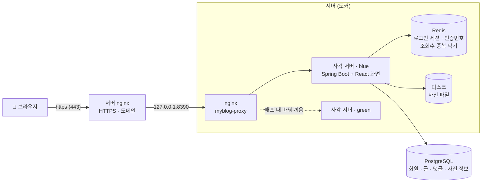
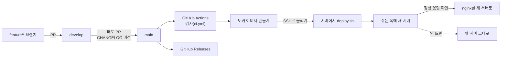

<div align="center">

# 사각

**여러 회원이 각자 블로그를 하나씩 운영하는 다이어리형 블로그 서비스**


</div>

| 항목 | 내용 |
|---|---|
| 사이트 | **https://sagak.java21.net** |
| 현재 버전 | v1.11.1 ([CHANGELOG](CHANGELOG.md)) |
| 기간 | 2026.10.08 ~ 2026.10.16 |
| 인원 | 1인 (개인 프로젝트) |
| 담당 | 사각의 기획 · 설계 · 백엔드 · 프론트엔드 · 배포 전부 |
| 개발 저장소 | [home-my-blog/myblog](https://github.com/home-my-blog/myblog) (PR · 이슈 · 릴리스 기록) |
| 문서 | [home-my-blog/docs](https://github.com/home-my-blog/docs) (기능 설명 · 동작 원리 · API · ERD) |
| 요구사항 · 스펙 | [`specs/001-blog-core/`](specs/001-blog-core/) |
| 개발 방식 | AI 코딩 에이전트(Claude Code)와 페어 프로그래밍. 방향 결정 · 검토 · 검증은 직접 수행([개발 방식](#개발-방식-ai-페어-프로그래밍)) |

## 소개

사각은 "내 다이어리를 꾸미며 쓰는 블로그"다. 회원마다 블로그가 하나 생기고, 블로그 안에 다이어리(분류)를 여러 권 만들어 글을 쓴다.

- **글쓰기**: 마크다운 에디터, 사진 업로드, 임시저장(60초 자동), 공개 · 구독자만 · 비공개
- **읽기와 소통**: 댓글 · 비밀 댓글, 좋아요, 블로그 · 다이어리 구독, 책갈피 폴더
- **탐색**: 분야별 글, 통합 검색, 실시간 인기 검색어(5초마다 갱신)
- **꾸미기**: 활동하면 잉크가 쌓이고, 잉크로 스티커를 사서 다이어리 표지를 꾸밈. 도전과제, 야간모드
- **회원**: 이메일 인증 가입, 카카오 · 구글 로그인, 비밀번호 찾기, 탈퇴 후 30일 안에 복구

| 메인 | 블로그와 다이어리 |
|---|---|
|  |  |
| **구독** | **스티커 상점** |
|  |  |

<sub>예시 데이터를 넣은 로컬 환경에서 찍은 화면</sub>

## 개발 방식: AI 페어 프로그래밍

AI 코딩 에이전트(Claude Code)를 페어 프로그래머로 두고 개발했다. 무엇을 만들지, 어떤 기술을 쓸지, 무엇을 합칠지는 직접 결정하고, AI는 그 결정을 스펙 · 코드 · 테스트로 옮기는 역할을 맡았다.

| 역할 | 담당 |
|---|---|
| 요구사항 정의, 기능 범위와 우선순위 결정 | 본인 |
| 기술 선택과 설계 방향의 최종 결정 (대안을 비교한 뒤 선택) | 본인 |
| 스펙 · 작업 목록 초안, 코드와 테스트 작성, 문서 초안 | Claude Code |
| 모든 PR 검토와 병합, 배포 승인 | 본인 |
| 실제 사이트에서 기능 검증, 문제 발견과 수정 요청 | 본인 |

**진행 방식**
1. 프로젝트 원칙 6가지를 먼저 정했다([`.specify/memory/constitution.md`](.specify/memory/constitution.md)): 요구사항 문서가 기준, 권한은 서버가 지킨다, 단순하게 시작, 핵심 흐름은 테스트로, 안전한 기본값, 기본값은 한곳에서.
2. 기능마다 요구사항 → 스펙 → 계획 → 작업 목록(spec-kit) 순서로 쪼개고, 각 단계 결과를 확인한 뒤 다음으로 넘어갔다.
3. 모든 변경은 `feature/*` 브랜치의 PR로 받아 CI(테스트 · 타입 검사 · 린트)와 SonarQube 품질 게이트를 통과한 것만 병합했다([의사결정 9](#9-코드-품질-게이트-기준을-못-넘으면-병합하지-않는다)).

**AI와 일하며 지킨 규칙**
- 화면이 바뀌는 작업은 시안(스크린샷)을 먼저 보고 승인한 뒤 구현
- 데이터를 지우는 명령처럼 되돌릴 수 없는 작업은 무엇이 사라지는지 설명을 듣고 승인한 뒤 실행
- 비밀번호 · 키는 대화에 쓰지 않고 GitHub Secrets에만 저장, 공개 저장소에 개인정보를 남기지 않음
- 작은 수정은 한 PR로 묶고, 버전 규칙(기능 묶음은 가운데 숫자, 작은 수정은 끝 숫자)에 맞춰 배포

**직접 검증으로 잡은 예**: 소셜 계정으로 탈퇴한 뒤 다시 로그인하면 묻지 않고 바로 복구되는 것을 실제 사이트에서 발견했다. 30일 복구 기간 때문에 생긴 동작이었지만 사용자가 의도하지 않은 복구라고 판단해, 복구 전에 확인을 묻도록 바꿔 v1.9.2로 배포했다.

## 기술 스택

| 영역 | 사용 기술 | 선택 이유 |
|---|---|---|
| 화면 | React 19, TypeScript, Vite | 글 목록 · 댓글 · 그래프처럼 자주 바뀌는 화면을 컴포넌트 단위로 나눠 관리. TypeScript로 API 응답 형태 실수를 컴파일 단계에서 차단 |
| 화면 데이터 | TanStack Query, react-markdown | 서버 데이터 캐시와 재요청을 직접 구현하지 않아도 됨. 글은 마크다운 원문으로 저장하고 그대로 렌더링 |
| 서버 | Java 21, Spring Boot 3.5 | 지원 중인 LTS 버전. record와 switch 패턴으로 DTO · 검증 코드가 짧아짐. 인증 · 세션 · DB 연결 도구가 갖춰져 있어 직접 작성할 코드가 적음 |
| 인증 | Spring Security, Spring Session | "로그아웃 즉시 끊김", "다른 기기 로그아웃" 요구사항은 JWT보다 서버 세션이 단순함([의사결정 1](#1-로그인-jwt-대신-세션--쿠키)) |
| DB 접근 | JdbcClient | JPA 대신 선택. 실행되는 SQL이 코드에 그대로 드러남 |
| 데이터 | PostgreSQL 16 | 회원 → 블로그 → 글 → 댓글로 강하게 연결된 데이터라 관계형 DB가 적합. 중복 금지 같은 규칙을 DB 제약으로 보장하고, `pg_trgm`으로 검색 서버 없이 한국어 부분 일치 검색 가능 |
| DB 변경 이력 | Flyway | 테이블을 단계적으로 늘려 가며 개발하므로, 어느 환경에서든 같은 순서로 스키마를 맞추기 위함 |
| 임시 저장 | Redis 7 | 인증번호 · 조회수 중복 방지처럼 곧 사라질 값은 만료 시간만 지정하면 됨. 배포 중에도 로그인을 유지하기 위해 세션도 저장. 공개 화면 응답 캐시(30초)로 메인 화면 처리량 약 154배 |
| 배포 | Docker, GitHub Actions, nginx | 로컬과 서버를 같은 이미지로 맞추고, main 병합 시 자동 배포. nginx로 블루-그린을 전환해 무중단 배포 |
| 협업 | Git Flow, PR 리뷰, CHANGELOG | 기능은 develop에 모아 한 번에 배포하고, 모든 변경을 PR로 검토. CHANGELOG 변경 시 GitHub Release 자동 생성 |

채택하지 않은 기술: **JWT**(로그아웃 즉시 무효화가 어려움), **MSA**(1인 개발이고 데이터가 강하게 연결돼 분리하면 오히려 복잡해짐), **RabbitMQ · Kafka**(비동기 작업이 메일 발송 정도라 `@Async`로 충분), **Elasticsearch**(글 수가 적어 PostgreSQL 검색으로 충분).



## 파일 구조

```text
myblog/
├── backend/                     Spring Boot 서버 (com.myblog)
│   └── src/main/
│       ├── java/com/myblog/
│       │   ├── member/          가입 · 로그인 · 소셜 로그인 · 마이페이지 · 탈퇴와 복구
│       │   ├── blog/            블로그 · 다이어리(분류) · 구독 · 분야
│       │   ├── post/            글 쓰기와 읽기 · 임시저장 · 태그 · 좋아요 · 책갈피
│       │   ├── comment/         댓글
│       │   ├── search/          통합 검색 · 실시간 인기 검색어
│       │   ├── shop/            잉크 · 스티커 상점 · 다이어리 꾸미기 · 도전과제
│       │   ├── image/           사진 올리기 (디스크 / S3 호환 저장소)
│       │   ├── manage/          내 블로그 관리 (글 · 댓글 모아 보기)
│       │   ├── home/            메인 화면
│       │   ├── stats/           조회수 · 방문자
│       │   ├── mail/            인증 메일 (SMTP / 로그)
│       │   ├── config/          보안 · 세션 쿠키 · 소셜 로그인 설정
│       │   └── common/          오류 응답 · 페이지 · Redis 보호 같은 공통 코드
│       └── resources/db/migration/   Flyway DB 변경 이력 (V1 ~ V25)
├── frontend/                    React 화면 (Vite)
│   └── src/
│       ├── pages/               화면 단위 페이지
│       ├── components/          공통 화면 조각
│       ├── api/                 서버 API 호출
│       ├── auth/                로그인 상태
│       └── messages.ts          화면 문구 모음
├── deploy/deploy.sh             블루-그린 무중단 배포 스크립트
├── specs/001-blog-core/         요구사항 · 스펙 · 설계 결정 (spec-kit)
├── Dockerfile                   화면과 서버를 이미지 하나로
├── docker-compose.yml           로컬 개발용 PostgreSQL · Redis · MinIO
└── CHANGELOG.md                 버전별 바뀐 점
```

## 기술적 의사결정

개발 중 고민한 지점과, 무엇을 왜 선택했는지 정리했다.

### 1. 로그인: JWT 대신 세션 + 쿠키
- **고민**: 화면(React)과 서버가 분리된 구조에서는 JWT를 흔히 쓰지만, JWT는 한 번 발급하면 만료 전까지 서버가 무효화하기 어렵다.
- **선택**: 서버 세션 + `HttpOnly` 쿠키. 화면과 서버를 같은 도메인에서 제공해 쿠키를 그대로 사용한다.
- **결과**: 비밀번호 변경이나 탈퇴 시 **다른 기기의 로그인도 즉시 끊긴다**. 자바스크립트가 쿠키를 읽을 수 없어 토큰 탈취 위험이 줄고, 대신 생기는 CSRF 위험은 `XSRF-TOKEN` 쿠키 + 헤더로 막았다. 로그인 5회 실패 시 10분간 잠그고, 없는 이메일도 같은 시간을 소요하게 해 응답 속도로 가입 여부를 알 수 없게 했다.

### 2. 무중단 배포: 블루-그린 + Redis 세션
- **문제**: 배포할 때 기존 서버를 내리고 새 서버를 올려 몇 초간 사이트가 끊겼다. 세션이 서버 메모리에 있어 **배포할 때마다 모든 회원이 로그아웃**됐고, 새 버전이 뜨지 않으면 사이트가 내려간 채로 남았다.
- **선택**:
  - 세션을 Redis로 옮겼다(Spring Session). 서버가 교체되거나 두 대가 동시에 떠 있어도 같은 로그인 상태를 본다.
  - 서버 안 8390 포트는 사각 nginx(`myblog-proxy`)가 받고, 대기 중인 쪽(blue/green)에 새 서버를 띄워 **정상 응답을 확인한 뒤에만** nginx를 전환한다. 기존 서버는 처리 중인 요청을 마치고 종료한다(graceful shutdown).
- **결과**: 0.2초 간격으로 요청을 보내며 배포한 결과 **끊김 0회**, 배포 전후 로그인 유지. 일부러 고장 낸 버전을 배포해도 기존 서버가 계속 서비스했다.
- **트레이드오프**: 전환 중 두 버전이 같은 DB를 쓰므로, 컬럼 삭제 · 이름 변경은 두 번의 배포로 나눠야 한다.

### 3. Redis: 필수 기능과 생략 가능한 기능 구분
- Redis는 "잠시만 기억하면 되는 값"에 쓴다: 인증번호(10분), 조회수 중복 방지(30분), 댓글 연타 방지(5초), 로그인 세션.
- `RedisGuard`로 두 경우를 구분했다. 인증번호처럼 **없으면 안 되는 기능**은 "잠시 후 다시 시도" 오류를 반환하고, 조회수 중복 방지처럼 **없어도 되는 기능**은 건너뛴다. Redis가 잠시 멈춰도 글 읽기는 계속된다.

### 4. 사진: 디스크 + DB 메타데이터, 확장자 대신 파일 내용으로 검사
- 사진 파일은 서버 디스크(도커 볼륨)에, 업로드한 사람 · 크기 같은 정보는 DB에 둔다. DB에 파일을 통째로 넣으면 DB가 무거워지고 백업도 느려진다.
- 저장소는 `ImageStorage` 인터페이스로 감싸, 설정 하나로 S3 호환 저장소(MinIO)로 교체할 수 있다.
- 파일 이름의 `.jpg`는 신뢰하지 않고 **파일 앞부분 바이트(매직 넘버)**로 실제 이미지인지 확인한다. 파일명은 UUID로 새로 지어 덮어쓰기와 개인정보 노출을 막았다.
- 글에 쓰이지 않은 채 24시간이 지난 사진은 1시간마다 정리한다.

### 5. 검색: Elasticsearch 대신 PostgreSQL pg_trgm
- 한국어 부분 일치 검색이 필요했지만, 이 규모에서 검색 서버를 따로 운영하는 것은 부담이 크다.
- PostgreSQL `pg_trgm` 인덱스 + `ILIKE`로 한국어 부분 일치 검색도 인덱스를 타게 했다.

### 6. 실시간 인기 검색어: 요청마다 계산하지 않기
- 요청마다 24시간치 검색 기록을 집계하면 사용자가 몰릴수록 DB 부하가 커진다.
- 5초마다 한 번 계산해 메모리에 두고, 요청은 계산된 결과만 가져간다. 점수는 검색 수 ×3 + 제목에 해당 단어가 포함된 글의 조회수 + 댓글 수 ×5.

### 7. 배포 단위와 버전 관리
- 작은 수정을 하나씩 배포하면 배포가 지나치게 잦아져, **Git Flow**를 간소화해 적용했다. 기능은 `feature/*` → `develop`에 모으고, 배포할 때만 `develop` → `main`으로 병합한다.
- `main`에 병합되면 GitHub Actions가 테스트 → 도커 이미지 빌드 → 서버 배포를 자동으로 수행한다. 비밀번호 같은 값은 코드가 아닌 GitHub Secrets에 둔다(공개 저장소이므로).
- 버전은 `vX.Y.Z` 형식으로, 기능 묶음은 가운데 숫자, 작은 수정은 끝 숫자를 올린다. `CHANGELOG.md`가 바뀌면 GitHub Release가 자동 생성된다.
- DB 구조는 Flyway의 번호 붙은 SQL 파일(V1~)로만 변경해, 어느 서버에서든 같은 순서로 적용된다.

### 8. 공개 화면 캐시: 세대 번호로 한꺼번에 무효화
- **문제**: 메인 화면은 한 번 열 때 쿼리 7개가 실행되고, 그중 인기 글 · 인기 다이어리는 글마다 좋아요 · 댓글 · 북마크 수를 세어 점수순으로 정렬한다. 글이 많아질수록 느려진다.
- **선택**: 누가 봐도 같은 공개 화면(메인, 분야별 글, 주제 화면) 응답을 Redis에 JSON으로 30초 보관한다(`ResponseCache`).
  - 키에 세대 번호를 붙이고, 글 작성 · 수정 · 삭제, 다이어리 공개 범위 변경, 탈퇴 시 번호만 올린다. `KEYS` 검색 없이 한 번에 무효화되고, 서버 두 대(blue/green)가 같은 캐시를 본다.
  - 무효화는 트랜잭션 **커밋 후**에 해서, 커밋 전 데이터가 다시 캐시되지 않게 했다.
  - 캐시가 빈 순간 같은 화면으로 몰린 요청은 한 요청만 DB에서 계산하고 나머지는 그 결과를 쓴다.
  - 좋아요 · 댓글 · 조회수는 너무 자주 바뀌어 매번 무효화하지 않고 TTL(최대 30초)로 반영한다.
  - Redis가 멈추면 캐시 없이 DB에서 바로 읽는다([의사결정 3](#3-redis-필수-기능과-생략-가능한-기능-구분)).
- **캐시하지 않은 곳**: 글 상세, 블로그 화면, 마이페이지는 로그인한 사람에 따라 보이는 글이 달라(구독자 전용 · 비공개) 캐시하면 다른 사람의 화면이 섞일 수 있다. 검색 결과는 검색어마다 달라 적중률이 낮다. 그래서 "누구에게나 같고 자주 열리는 화면"에만 적용했다.
- **결과**: 아래 [성능 개선](#성능-개선) 표 참고.

### 9. 코드 품질 게이트: 기준을 못 넘으면 병합하지 않는다
- **고민**: AI가 작성한 코드가 많아, 사람의 리뷰만으로는 버그 · 보안 취약점을 놓칠 수 있다.
- **선택**: SonarQube Cloud를 CI에 붙이고, 새로 쓴 코드 기준으로 버그 0 · 보안 취약점 0 · 테스트 커버리지 80% 이상 · 중복 3% 이하를 품질 게이트로 정했다. 커버리지는 서버(JaCoCo)와 화면(Vitest) 모두 보고한다.
- **강제**: GitHub 브랜치 규칙으로 `develop` · `main`은 테스트 · SonarQube 검사를 통과해야만 병합할 수 있고, 관리자도 예외 없이 막힌다.
- **결과**: 도입 직후 CI 설정에서 보안 지적 2건(외부 액션을 버전 이름 대신 커밋 SHA로 고정, 패키지 설치 스크립트 실행 차단)을 잡아 고쳤다. 이후 기존 코드의 지적도 정리해 **신뢰성 · 보안 · 유지보수성 모두 A, 미해결 이슈 0개, 전체 커버리지 약 90%**가 됐다.
  - 화면 테스트가 부족해 프론트 커버리지가 34%였다. 숫자를 맞추려고 측정에서 빼는 대신 실제 사용 흐름(입력 · 클릭 · 서버 요청)을 확인하는 테스트 241개를 더해 94%로 올렸다.
  - 이슈 229개는 규칙마다 우리 코드에 맞는지 판단해 고치고, 맞지 않는 것(의도한 autoFocus, 올바른 ARIA role, 비밀번호 안내 문구 상수 이름 등)은 이유를 남겨 오탐 · 수용으로 처리했다.
  - 게이트가 내 실수도 잡았다. 이메일 검사식을 고치면서 남긴 "긴 입력에서 스택이 넘칠 수 있는 반복"과 새 코드의 테스트 부족(커버리지 61%)을 병합 전에 막아, 소유 수량자로 다시 고치고 테스트를 더한 뒤 병합했다.

### 10. 앱 포트 숨기기: 리버스 프록시만 바깥에 연다
- **문제**: 사각 nginx(8390)가 모든 주소에 열려 있어, `http://공인IP:8390`으로 들어오면 도메인과 HTTPS를 건너뛰고 사이트에 접속할 수 있었다. 이 길로 로그인하면 비밀번호가 암호화 없이 오간다.
- **선택**: 8390을 서버 안(`127.0.0.1`)에서만 받게 하고(`deploy.sh`의 `PROXY_BIND`), 바깥에서는 서버 nginx(443, Certbot 인증서)를 통해서만 들어오게 했다. 브라우저가 항상 HTTPS로만 접속하도록 HSTS 헤더도 붙였다.
- **결과**: `https://sagak.java21.net`은 그대로 열리고, `http://공인IP:8390`은 열리지 않는 것을 외부망(휴대폰 데이터)에서 확인했다.
- **롤링 배포 대신 블루-그린을 고른 이유**: nginx 무료 버전은 서버가 살아 있는지 미리 확인하는 액티브 헬스 체크가 없어, 롤링 배포는 `max_fails` 같은 패시브 헬스 체크(실제 요청이 실패해야 알아챔)에 기대야 한다. 사각은 배포 스크립트가 새 서버에 실제 요청을 보내 확인(3초 간격, 최대 3분)한 뒤에만 전환하므로, 고장 난 버전이 손님을 받지 않는다.

### 11. 비밀 댓글: 화면이 아니라 서버에서 가린다
- **문제**: 비밀 댓글을 화면에서만 숨기면 개발자 도구로 API 응답을 열어 내용을 볼 수 있다.
- **선택**: 서버가 보는 사람을 확인해, 볼 수 없는 사람에게는 내용 · 작성자를 응답에 **아예 넣지 않고** `hidden: true`만 보낸다. 볼 수 있는 사람은 쓴 사람, 그 글의 블로그 주인, (답글이면) 원 댓글을 쓴 사람이다.
  - 비밀 댓글의 답글은 늘 비밀이다. 공개로 달 수 있으면 답글에 질문 내용이 드러난다.
  - 볼 수 없는 비밀 댓글에 답글을 달려고 하면 "없는 댓글"과 같은 오류를 돌려, 그 댓글이 있는지도 알 수 없게 했다.
- **DB**: `comments.secret` 컬럼 하나(기본 false)만 더했다(V25). 컬럼 추가만이라 블루-그린 전환 중 옛 서버도 그대로 동작한다.
- **개발 과정** (v1.11.0 → v1.11.1, 하루):
  1. 공통 요구사항에 없는 기능이라 "누가 보나 · 답글은 어떻게 되나 · 못 보는 사람은 무엇을 받나"를 먼저 정했다.
  2. 정상 · 경계 · 예외 테스트를 먼저 정했다. 서버 통합 테스트 5개(쓴 사람 · 주인 / 다른 회원 · 손님, 기본값, 답글 강제 비밀, 못 보는 댓글에 답글 막기, 공개 댓글의 비밀 답글), 화면 테스트 5개.
  3. 화면이 늘 `secret: false`를 보내게 했더니 기존 테스트 2개가 깨졌다. 기대값을 바꾸지 않고 `secret`을 true일 때만 보내도록 구현을 고쳤다. 옛 요청 형식도 그대로 동작한다.
  4. PR → 품질 게이트 → develop → main(E2E 포함) → 블루-그린 배포 → 실제 사이트 확인 순서로 내보냈다.
  5. 직접 써 보니 🔒 이모지가 사이트 아이콘들과 어울리지 않아, 같은 선 모양 SVG 아이콘으로 바꿨다(v1.11.1).

## 성능 개선

로컬에서 글 20,769개 · 좋아요 58,256개 · 댓글 43,648개를 넣고 Apache Bench(`ab -c 10`, 동시 10명)로 측정했다.

| API | 캐시 전 | 캐시 후 | 개선 |
|---|---|---|---|
| 메인 (`/api/home`) | 초당 18.6건, 중앙값 485ms, 95% 734ms | 초당 **2,868건**, 중앙값 3ms, 95% 6ms | 약 **154배** |
| 인기순 글 목록 (`/api/posts?sort=popular`) | 초당 33.8건, 중앙값 249ms | 초당 **4,937건**, 중앙값 2ms | 약 **146배** |
| 주제 화면 (`/api/topics/{code}`) | 초당 476.8건, 중앙값 19ms | 초당 **4,874건**, 중앙값 2ms | 약 **10배** |

## 트러블슈팅

| 문제 | 원인 | 해결 | 결과 |
|---|---|---|---|
| 배포할 때마다 모든 회원이 로그아웃 | 세션이 서버 메모리에 있음 | Redis 세션 + 블루-그린 배포 | 0.2초 간격 요청 중 배포해도 끊김 **0회**, 로그인 유지 |
| Redis로 옮긴 뒤 두 번째 요청부터 401 | 연장 쿠키에 세션 ID를 base64 인코딩 없이 담음 | 쿠키 값 형식 통일 + 재요청 테스트 추가 | 재발 방지 테스트 확보 |
| 맞는 비밀번호로 DB 접속 실패 | 도커 볼륨에 예전 비밀번호가 남음 | `ALTER USER`로 비밀번호만 변경 | 데이터 손실 없이 해결 |
| 공인 IP:8390으로 HTTPS를 건너뛰고 접속됨 | 사각 nginx 포트가 모든 주소에 열려 있음 | `127.0.0.1` 바인딩 + HSTS | 도메인(HTTPS)으로만 접속 가능 |
| 테스트는 도는데 SonarCloud 첫 화면에 커버리지가 없음 | CI가 develop에 병합된 뒤에는 돌지 않음 + 자동 분석과 충돌 | 자동 분석 끄기, develop push에도 CI 실행 | 커버리지 표시(현재 약 90%) |
| 화면 테스트가 전체 실행 때만 가끔 실패 | 화면 이동 · 응답 반영을 기다리지 않고 다음 확인을 함 | "무엇이 끝났는지"를 기다리는 조건으로 수정 | 연속 5회 실행 모두 통과 |
| 이메일 검사가 긴 입력에서 느려질 수 있음 | 두 부분이 같은 글자를 나눠 먹는 정규식(되돌아가기 폭증) | 도메인을 점으로 나뉜 조각으로 + 소유 수량자 | 10만 자 입력도 즉시 판정, 틀린 주소(`a@b..c`)도 차단 |

### 배포할 때마다 모든 회원이 로그아웃됨
- **증상**: 새 버전을 배포하면 로그인했던 사용자가 모두 다시 로그인해야 했다.
- **원인**: 로그인 세션을 서버 메모리에 두고 있어, 서버를 새로 띄우면 세션도 함께 사라졌다.
- **해결**: 세션을 Redis(Spring Session)로 옮기고 블루-그린 배포를 적용했다. 서버가 교체되어도 Redis의 세션을 그대로 읽는다. ([기술적 의사결정 2](#2-무중단-배포-블루-그린--redis-세션))

### 세션을 Redis로 옮긴 뒤 두 번째 요청부터 로그인이 풀림
- **증상**: 로그인 → 블로그 설정 저장까지는 되지만, 그다음 요청이 401(로그인 필요)이 됐다. 자동 테스트는 모두 통과한 상태였다.
- **원인**: Spring Session은 쿠키에 세션 ID를 **base64로 인코딩**해 담는데, "요청마다 7일 연장" 필터는 ID를 **그대로** 담아 다시 내려보냈다. 브라우저가 연장된 쿠키를 보내면 서버가 그 값을 base64로 디코딩하다 세션을 찾지 못했다. 테스트가 연장된 쿠키로 재요청하는 경우를 다루지 않아 놓쳤다.
- **해결**: 쿠키 값 형식을 세션 ID 그대로 쓰도록 맞추고, "연장된 쿠키로 재요청" 테스트를 추가했다. 이후 배포 전에 실제 사용 흐름(가입 → 로그인 → 글쓰기)을 끝까지 확인하는 절차를 두었다.

### 로컬 DB 비밀번호가 맞는데도 접속 실패
- **증상**: `.env`의 `DB_PASSWORD`로 서버를 실행하면 `password authentication failed`가 발생했다.
- **원인**: PostgreSQL 도커 이미지는 `POSTGRES_PASSWORD`를 **DB를 처음 만들 때 한 번만** 적용한다. 예전에 다른 비밀번호로 만든 데이터 볼륨이 남아 있어, `.env`를 바꿔도 DB 안의 비밀번호는 그대로였다.
- **해결**: 데이터를 지우는 `docker compose down -v` 대신 `ALTER USER`로 DB 안의 비밀번호만 `.env`에 맞췄다. 데이터는 유지한 채 문제만 해결했다.

### 공인 IP로 들어오면 HTTPS를 건너뛸 수 있었음
- **증상**: `https://sagak.java21.net` 말고 `http://서버IP:8390`으로도 사이트가 열렸다. 이 길로 로그인하면 비밀번호가 암호화 없이 오간다.
- **원인**: 블루-그린 전환용 사각 nginx 컨테이너를 `-p 8390:8390`으로 띄워, 서버의 모든 주소(공인 IP 포함)에서 요청을 받았다.
- **해결**: 서버 nginx가 같은 서버에서 `127.0.0.1:8390`으로 넘겨 준다는 걸 확인한 뒤, 8390을 `127.0.0.1`에서만 받게 바꾸고 HSTS를 붙였다. 바인딩은 실행 중에 못 바꾸므로 배포 스크립트가 주소가 바뀌었을 때만 nginx 컨테이너를 다시 띄우게 했다. 외부망(휴대폰 데이터)에서 도메인은 열리고 IP:8390은 막힌 것을 확인했다. ([기술적 의사결정 10](#10-앱-포트-숨기기-리버스-프록시만-바깥에-연다))

### 테스트는 도는데 SonarCloud 첫 화면에 커버리지가 비어 있음
- **증상**: PR 화면에는 커버리지가 나오는데, SonarCloud 첫 화면(develop)은 커버리지가 비어 있었다.
- **원인**: 두 가지가 겹쳤다. ① SonarCloud는 저장소 기본 브랜치(develop)를 첫 화면에 보여 주는데, CI는 PR과 main 배포 때만 돌아 develop은 병합 후 다시 분석되지 않았다. ② 그 전에 켜져 있던 자동 분석(Automatic Analysis)은 커버리지를 재지 못하고, CI 분석과 동시에 켜져 있으면 CI가 실패했다.
- **해결**: 자동 분석을 끄고(토큰 → 시크릿 등록 → 끄기 순서로, 순서가 바뀌면 필수 검사가 사라져 모든 병합이 막힌다), develop에 push될 때도 CI가 돌게 했다. 그 뒤 화면 커버리지가 34%로 낮은 것이 드러나 화면 테스트를 보강했다.

### 화면 테스트가 전체 실행 때만 가끔 실패함
- **증상**: 파일 하나만 돌리면 통과하는데, 전체를 돌리면 가끔 "탈퇴 후 홈으로 이동", "잉크 적립 알림" 테스트가 실패했다.
- **원인**: 화면 이동이나 서버 응답 반영이 끝나기 전에 다음 확인을 했다. 컴퓨터가 바쁠 때만 순서가 뒤집혀 드러나는 경쟁 상태였다.
- **해결**: 시간을 늘리는 대신 "주소가 바뀌었는지", "첫 응답이 반영됐는지"를 기다리는 조건으로 바꿨다. 전체를 연속 5회 실행해 모두 통과하는 것을 확인했다.

### 이메일 검사식이 긴 입력에서 느려질 수 있었음
- **증상**: SonarCloud가 이메일 검사 정규식 `[^\s@]+@[^\s@]+\.[^\s@]+`을 "입력 길이에 따라 실행 시간이 크게 늘 수 있음(ReDoS)"으로 지적했다.
- **원인**: `@` 뒤 두 부분이 모두 점(`.`)을 먹을 수 있어, 형식이 틀린 긴 입력에서 나눌 수 있는 경우를 전부 되돌아가며 시도한다.
- **해결**: 도메인을 "점으로 나뉜 조각"으로 바꿔 한 번 읽고 끝나게 했다. 고친 식에도 "반복 그룹이 긴 입력에서 스택을 넘칠 수 있다"는 지적이 남아 품질 게이트가 병합을 막았고, 되돌아가지 않는 소유 수량자(`++`)로 다시 고쳤다. 서버와 화면이 같은 규칙을 쓰고, 덤으로 `a@b..c`처럼 틀린 주소도 막는다.

## 문서

- [home-my-blog/docs](https://github.com/home-my-blog/docs): 기능 설명, 동작 원리, 기획 기록
- [기능 설명](https://github.com/home-my-blog/docs/blob/main/docs/기능/00-목차.md), [동작 원리](https://github.com/home-my-blog/docs/blob/main/docs/원리/00-목차.md)
- 스펙과 설계 결정: [`specs/001-blog-core/`](specs/001-blog-core/) (`research.md`에 결정과 대안)
- 변경 이력: [CHANGELOG.md](CHANGELOG.md)

## 개발 환경 (로컬 실행)

DB와 Redis는 docker compose로 띄우고, 서버(8080)와 화면(5173)은 로컬에서 직접 실행한다. 화면 개발 서버가 `/api` 요청을 서버로 넘겨 주므로 배포 환경과 같은 주소 구조로 개발할 수 있다.

```bash
cp .env.example .env              # DB_PASSWORD 등을 채운다
docker compose up -d db redis     # MinIO까지 쓰려면: docker compose --profile minio up -d
cd backend && ./gradlew bootRun   # http://localhost:8080, Flyway가 표와 주제를 만든다 (8080이 쓰이고 있으면 SERVER_PORT=8081)
cd frontend && npm install && npm run dev   # http://localhost:5173 (/api는 8080으로 넘긴다)
```

메일은 기본값(`MYBLOG_MAIL_MODE=log`)이면 실제로 보내지 않고 인증번호를 서버 로그에 출력한다.
이미지는 기본으로 `backend/data/images`에 저장한다(`MYBLOG_IMAGE_STORAGE=s3`이면 MinIO).

## 테스트

테스트 도구 · 피라미드 · 단계별 실행 · AI와 일하는 규칙은 [TESTING.md](TESTING.md)에 정리했다. 핵심 흐름 3개는 Playwright 종단 테스트(`frontend/e2e`)로 확인한다.

```bash
# 서버: PostgreSQL의 myblog_test DB와 Redis가 떠 있어야 한다
createdb -h localhost -U myblog myblog_test
cd backend && DB_USERNAME=myblog DB_PASSWORD=... ./gradlew test

# 화면
cd frontend && npm run lint && npm run typecheck && npm test
cd frontend && npm run test:coverage   # 커버리지 보고서 (SonarQube가 읽는 coverage/lcov.info)
```

- 서버 127개(실제 PostgreSQL · Redis를 쓰는 통합 테스트 포함), 화면 297개. PR마다 CI에서 전부 실행하고, SonarQube가 커버리지를 함께 본다.
- 화면 테스트는 버튼을 누르고 입력해 본 뒤, 보이는 문구와 서버로 보낸 요청(주소 · 본문)을 확인한다. 서버 응답은 가짜로 대신하므로, 진짜 서버와의 연결은 서버 통합 테스트가 맡는다.

## 배포



`main`에 푸시되거나 PR이 병합되면 GitHub Actions(`.github/workflows/deploy.yml`)가 자동으로 배포한다.

1. 검사(`ci.yml`)를 먼저 실행하고, 통과하면 도커 이미지를 빌드한다(`Dockerfile`, 화면과 서버를 이미지 하나로).
2. 이미지 파일과 `deploy/deploy.sh`를 SSH로 서버의 `~/myblog-deploy`에 업로드한다.
3. 서버에서 `deploy/deploy.sh`가 **무중단(블루-그린)** 으로 교체한다. 8390 포트는 nginx(`myblog-proxy`)가 서버 안(`127.0.0.1`)에서만 받고(서버 nginx가 HTTPS로 받아 넘겨 준다),
   뒤에서 `myblog-blue`/`myblog-green` 중 하나가 요청을 처리한다. 대기 중인 쪽에 새 서버를 띄워 정상 응답을 확인한 뒤 nginx를 새 서버로 전환하고,
   기존 서버는 처리 중인 요청을 마치고 종료한다. 새 서버가 뜨지 않으면 새 서버만 지우고 사이트는 기존 서버로 유지한다.
   로그인 세션은 Redis(Spring Session)에 있어 배포해도 로그아웃되지 않는다.
   새 서버가 뜨는 동안 기존 서버도 같은 DB를 쓰므로, 컬럼 삭제 · 이름 변경 같은 DB 변경은 두 번의 배포로 나눠 진행한다.

필요한 저장소 시크릿: `SSH_ADDRESS`, `SSH_PORT`, `SSH_ID`, `SSH_PASSWORD`, `DB_ADDRESS`, `DB_PORT`, `DB_NAME`, `DB_SCHEMA`, `DB_USERNAME`, `DB_PASSWORD`.
선택 저장소 시크릿: `SMTP_HOST`, `SMTP_PORT`(기본 587), `SMTP_USERNAME`, `SMTP_PASSWORD`, `MAIL_FROM` — `SMTP_HOST`가 있으면 인증번호를 실제 메일로 보낸다. 없으면 메일을 보내지 않고 가입 인증번호만 화면에 표시한다(비밀번호 찾기는 사용 불가).
선택 소셜 로그인: 시크릿 `KAKAO_CLIENT_ID`, `KAKAO_CLIENT_SECRET`, `GOOGLE_CLIENT_ID`, `GOOGLE_CLIENT_SECRET`과 저장소 변수 `SITE_URL`(기본 `https://sagak.java21.net`) — CLIENT_ID가 있는 제공자만 버튼이 보이며, 각 개발자 콘솔에 리디렉션 주소 `<SITE_URL>/login/oauth2/code/kakao`(구글은 `/google`)를 등록한다.
선택 저장소 변수(Variables): `NOTICE_OWNER_EMAIL` — 공지사항을 작성하는 회원의 이메일. 그 회원 블로그의 **'공지'** 다이어리에 올린 공개 글이 `/notices`(공지사항)와 메인 공지 띠에 표시된다. 비워 두면 공지사항은 빈 화면이다.
서버에는 docker가 설치돼 있어야 하고 SSH 계정이 docker를 사용할 수 있어야 한다(`sudo usermod -aG docker <계정>`).
업로드한 사진은 서버의 `~/myblog-data/images`에 저장된다. 수동 배포는 Actions 탭의 deploy에서 "Run workflow"로 실행한다.
